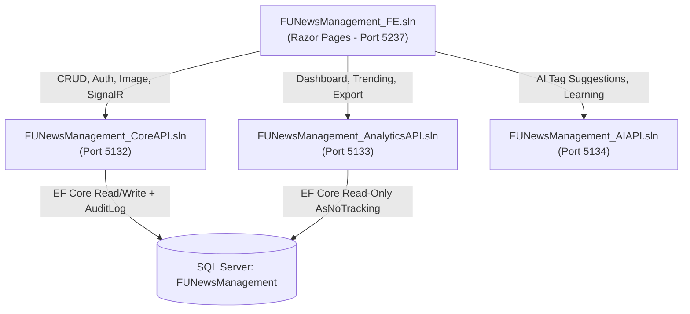

# FUNewsManagementSystem v2 - Distributed & Intelligent News Architecture

**Course**: PRN232 - Advanced Cross-Platform Web Development with .NET  
**Assignment**: Assignment 02 - Distributed & Intelligent News System  
**Framework**: .NET 8.0 (LTS)  
**Database**: Microsoft SQL Server (`FUNewsManagement`)  

---

## 1. System Architecture & Topology

The system is decoupled into **4 independent .NET 8 solutions** communicating exclusively via RESTful HTTP APIs and SignalR WebSockets:



| # | Solution Name | Port | Primary Responsibilities |
| :--- | :--- | :--- | :--- |
| **1** | `FUNewsManagement_CoreAPI.sln` | `5132` | Identity (JWT + Refresh Token rotation & reuse detection), CRUD (Account, Category, Tag, NewsArticle), Image Upload (2MB limit), EF Core ChangeTracker Audit Logging, SignalR Notification Hub (`/hubs/notifications`). |
| **2** | `FUNewsManagement_AnalyticsAPI.sln` | `5133` | Read-only analytics using `AsNoTracking()`. Endpoints: `/api/analytics/dashboard`, `/api/analytics/trending`, `/api/recommend/{id}`, and ClosedXML streaming `/api/analytics/export`. |
| **3** | `FUNewsManagement_AIAPI.sln` | `5134` | OpenAI Chat Completions tag extraction (`gpt-4o-mini`) with confidence scores (0.0 to 1.0), in-memory `LearningCache` with boost scores, and learning endpoint `/api/ai/learn`. |
| **4** | `FUNewsManagement_FE.sln` | `5237` | Razor Pages Web UI with **zero direct DB access**. Configured with `HttpClientFactory` named clients, Polly Resilience (Retry + Fallback), thread-safe token refresh `DelegatingHandler` (`SemaphoreSlim`), 6-hour `PeriodicTimer` Background Worker, Chart.js visualizations, SignalR real-time Toast, and Sticky Offline Mode banner. |

---

## 1.1. Environment Configuration & Secrets Setup

For security, all sensitive credentials (API keys, JWT secret keys, Cloudinary tokens, and SQL Server connection strings) in `appsettings.json` are excluded from Git tracking via `.gitignore`. 

Each service contains an `appsettings.sample.json` template. Copy each sample file to `appsettings.json` and provide your specific credentials:

### 1. Core API (`FUNewsManagement_CoreAPI/FUNewsManagement_CoreAPI/appsettings.json`)
Copy from [appsettings.sample.json](file:///d:/Dev_Web/Assigment_1/FUNewsManagement_CoreAPI/FUNewsManagement_CoreAPI/appsettings.sample.json):
- `ConnectionStrings:MyCnn`: Your SQL Server connection string.
- `AdminAccount:Password`: Initial administrator password.
- `Jwt:Key`: Secret key for JWT signing (at least 32 characters).
- `Cloudinary`: Your Cloudinary `CloudName`, `ApiKey`, and `ApiSecret`.

### 2. Analytics API (`FUNewsManagement_AnalyticsAPI/FUNewsManagement_AnalyticsAPI/appsettings.json`)
Copy from [appsettings.sample.json](file:///d:/Dev_Web/Assigment_1/FUNewsManagement_AnalyticsAPI/FUNewsManagement_AnalyticsAPI/appsettings.sample.json):
- `ConnectionStrings:MyCnn`: Your SQL Server connection string.

### 3. AI API (`FUNewsManagement_AIAPI/FUNewsManagement_AIAPI/appsettings.json`)
Copy from [appsettings.sample.json](file:///d:/Dev_Web/Assigment_1/FUNewsManagement_AIAPI/FUNewsManagement_AIAPI/appsettings.sample.json):
- `GoogleAI:ApiKey`: Google AI Studio Gemini API key.
- `OpenAI:ApiKey`: (Optional) OpenAI API key for Tier-2 fallback.

### 4. Frontend (`FUNewsManagement_FE/FUNewsManagement_FE/appsettings.json`)
Copy from [appsettings.sample.json](file:///d:/Dev_Web/Assigment_1/FUNewsManagement_FE/FUNewsManagement_FE/appsettings.sample.json):
- Pre-configured to connect to Core API (`5132`), Analytics API (`5133`), AI API (`5134`), and SignalR Hub.

---

## 2. Database Setup & Hard Business Rules

### 2.1. SQL Database Setup
The database schema and seed data are located in `FUNewsManagement.sql`:
- **New Tables**:
  - `AuditLog`: `Id`, `UserId`, `Action`, `EntityName`, `Timestamp`, `BeforeJson`, `AfterJson`.
  - `RefreshToken`: `Id`, `Token`, `JwtId`, `IsUsed`, `IsRevoked`, `ExpiryDate`, `AccountId`.
- **New Columns on `NewsArticle`**:
  - `ImageUrl`: `NVARCHAR(500) NULL`
  - `ViewCount`: `INT NOT NULL DEFAULT 0`

Execute via SQL Server Management Studio (SSMS) or PowerShell:
```powershell
sqlcmd -S "MONOME\SQLEXPRESS" -i "FUNewsManagement.sql"
```

### 2.2. Enforced Business Constraints (HTTP 400 Bad Request)
- **Category Deletion**: Rejected if any `NewsArticle` is linked to the Category.
- **Account Deletion**: Rejected if the Account has authored any `NewsArticle` (`CreatedById`). The system Administrator (`AccountId = 0`) cannot be deleted.
- **Account Password Change**: Validates the old password against stored hash before updating.
- **Tag Creation**: Case-insensitive uniqueness check rejects duplicate tag names.
- **Image Upload**: Validates MIME types/extensions (`.jpg`, `.jpeg`, `.png`, `.webp`) and enforces a **2MB maximum file size limit**.

---

## 3. How to Launch the Solutions

### Option A: One-Click Launch Script (Recommended)

Run the included PowerShell script to launch all 4 services in separate terminal windows automatically:
```powershell
.\run-all.ps1
```
To cleanly stop all running services:
```powershell
.\stop-all.ps1
```

### Option B: Run Services Manually (Strict Order)

Open 4 separate terminal windows and run each service in the following exact order:

**Terminal 1 (First) - Core API (Port 5132):**
```powershell
cd FUNewsManagement_CoreAPI\FUNewsManagement_CoreAPI
dotnet run --urls "http://localhost:5132"
```

**Terminal 2 - Analytics API (Port 5133):**
```powershell
cd FUNewsManagement_AnalyticsAPI\FUNewsManagement_AnalyticsAPI
dotnet run --urls "http://localhost:5133"
```

**Terminal 3 - AI API (Port 5134):**
```powershell
cd FUNewsManagement_AIAPI\FUNewsManagement_AIAPI
dotnet run --urls "http://localhost:5134"
```

**Terminal 4 - Frontend Web App (Port 5237):**
```powershell
cd FUNewsManagement_FE\FUNewsManagement_FE
dotnet run --urls "http://localhost:5237"
```

### Option C: Visual Studio 2022
Open any of the 4 individual solution files:
- `FUNewsManagement_CoreAPI.sln`
- `FUNewsManagement_AnalyticsAPI.sln`
- `FUNewsManagement_AIAPI.sln`
- `FUNewsManagement_FE.sln`

---

## 4. Test Accounts & Role Access Matrix

| Role | Email | Password | Allowed Navigation & Permissions |
| :--- | :--- | :--- | :--- |
| **Admin** | `admin@FUNewsManagementSystem.org` | `@@abc123@@` | - Account Management (`/Admin/Accounts`)<br/>- Executive Analytics & Excel Export (`/Admin/Reports`)<br/>- Audit Logs Viewer (`/Admin/AuditLogs`) |
| **Staff** | `IsabellaDavid@FUNewsManagement.org` | `@1` | - News Management with AI Tags & Image Upload (`/Staff/Articles`)<br/>- Category Hierarchy Management (`/Staff/Categories`)<br/>- Tag Management (`/Staff/Tags`)<br/>- Profile & Password Change (`/Staff/Profile`) |
| **Lecturer** | `EmmaWilliam@FUNewsManagement.org` | `@1` | - Read-Only News Explorer (`/Lecturer/Articles`) |
| **Guest** | *(Anonymous)* | *(None)* | - Public News Portal (`/`)<br/>- Top 3 Recommended Articles Modal (`/api/recommend/{id}`) |

*(Other test staff accounts: `MichaelCharlotte@FUNewsManagement.org` / `@1`, `SteveParis@FUNewsManagement.org` / `@1`).*

---

## 5. API Endpoints Reference

### 5.1. Core API (`http://localhost:5132`)
- `POST /api/auth/login`: Authenticate and receive JWT (15-min expiry) + Refresh Token (7-day expiry).
- `POST /api/auth/refresh`: Rotate refresh token. Includes **Token Reuse Detection** (if a used/revoked token is replayed, all active sessions for that account are revoked).
- `GET /api/news`: List news articles (supports OData query options).
- `POST /api/news`: Create news article and broadcast `ReceiveNewArticleNotification` via SignalR.
- `POST /api/news/upload-image`: Upload article thumbnail image (2MB limit, validated format).
- `GET /api/auditlog`: Admin endpoint for querying EF Core audit log entries with pagination and user/entity filters.
- `GET /hubs/notifications`: SignalR WebSocket hub endpoint (extracts JWT from query parameter `access_token`).

### 5.2. Analytics API (`http://localhost:5133`)
- `GET /api/analytics/dashboard`: Aggregate total articles by Category, Status (Active/Inactive), and Author. Supports `startDate`, `endDate`, `categoryId`, and `authorId` query filters.
- `GET /api/analytics/trending`: Top articles ranked by `ViewCount` descending.
- `GET /api/recommend/{id}`: Top 3 related articles based on category match and shared tag count.
- `GET /api/analytics/export`: ClosedXML streaming `.xlsx` spreadsheet matching applied filters.

### 5.3. AI API (`http://localhost:5134`)
- `POST /api/ai/suggest-tags`: Extract keywords and tags with confidence scores (0.0 to 1.0) using Google AI Studio (Gemini) / OpenAI Chat Completions with NLP heuristic offline fallback. Tags with high selection history receive automatic confidence boosts.
- `POST /api/ai/learn`: Accept confirmed tags array from Staff article publish and increment selection counts in `LearningCache`.
- `GET /api/ai/cache`: Inspect current Learning Cache state and tag frequencies.

---

## 6. Frontend Resilience & UX Features

1. **HttpClient & Thread-Safe Token Refresh**: Custom `TokenRefreshDelegatingHandler` uses `SemaphoreSlim(1, 1)` to prevent race conditions during concurrent 401 token refresh requests.
2. **Polly Resilience**: Named clients use `WaitAndRetryWithJitter` + Fallback policies for network drops and 5xx errors.
3. **Offline Mode**:
   - Connectivity drops trigger a sticky top banner: *"Offline Mode - System is currently unreachable"*.
   - Serves cached data for read-only viewing.
   - Automatically disables all Create, Edit, and Delete action buttons across all views.
4. **Background Worker**: `DataCacheRefreshWorker` runs every 6 hours using `PeriodicTimer`, safely creating an `IServiceScope` via `IServiceScopeFactory` to refresh dashboard and category caches.
5. **Chart.js Visualizations**: Interactive Bar and Doughnut charts on `/Admin/Reports`.
6. **SignalR Real-Time Notifications**: Automatically connects to `/hubs/notifications`, triggers Toast notifications on new article events, and retains the latest 10 notifications in the navigation bell dropdown.
7. **AI Tag Assistant**: Modal AJAX button suggests tags rendered as clickable chips with confidence badges; clicking auto-selects the tag and saves trigger learning feedback via `POST /api/ai/learn`.
8. **Audit Log Inspection**: Interactive Admin view (`/Admin/AuditLogs`) displaying who made each change, timestamp, and modal Before/After JSON diff inspection.
